# جسور | JUSOOR — مخطط قاعدة البيانات العلائقية (ERD)

تعتمد منصة **جسور | JUSOOR** بنية علائقية مطبّعة (Normalized Relational Schema) تضم **65 جدولاً** مع مفاتيح خارجية صريحة (`FOREIGN KEY`) وقيود فرادة (`UNIQUE`) وفهارس أداء (`INDEX`) وجداول ربط متعددة الأطراف (Junction Tables).

- **محرك التنفيذ الحي في بيئة السحابة**: PostgreSQL (Cloud SQL) عبر Drizzle ORM (`src/db/schema.ts`).
- **مرجع التوافق مع MySQL 8.0+**: متوفر في `docs/mysql_reference_schema.sql`.

---

## مخطط الكيانات والعلاقات الرئيسي (Mermaid ERD)

```mermaid
erDiagram
    users ||--o{ user_roles : has
    roles ||--o{ user_roles : assigned_to
    users ||--o| student_profiles : has
    users ||--o| provider_profiles : has
    educational_stages ||--o{ student_profiles : targets

    educational_stages ||--o{ educational_systems : contains
    educational_systems ||--o{ educational_grades : structures
    educational_grades ||--o{ secondary_divisions : branches_into
    educational_grades ||--o{ baccalaureate_pathways : tracks_into
    academic_years ||--o{ curriculum_versions : versions
    curriculum_versions ||--o{ curriculum_subjects : defines
    educational_grades ||--o{ grade_subjects : maps
    subjects ||--o{ grade_subjects : mapped_in
    subjects ||--o{ curriculum_subjects : scheduled_as
    curriculum_subjects ||--o{ teacher_teaching_assignments : assigned_to
    users ||--o{ teacher_teaching_assignments : teaches

    users ||--o{ centers : owns
    centers ||--o{ center_members : employs
    users ||--o{ center_members : member

    fields ||--o{ subjects : contains
    fields ||--o{ courses : classifies
    educational_stages ||--o{ courses : targets
    users ||--o{ courses : instructs
    centers ||--o{ courses : hosts
    courses ||--o{ course_lessons : contains

    users ||--o{ enrollments : enrolls
    courses ||--o{ enrollments : receives
    enrollments ||--o| progress : tracks
    enrollments ||--o{ lesson_progress : records
    course_lessons ||--o{ lesson_progress : completed_in

    courses ||--o{ quizzes : includes
    quizzes ||--o{ questions : has
    questions ||--o{ quiz_answers : defines
    quizzes ||--o{ quiz_attempts : attempted_by
    users ||--o{ quiz_attempts : takes
    quiz_attempts ||--o{ quiz_attempt_answers : records

    courses ||--o{ assignments : includes
    assignments ||--o{ assignment_submissions : receives
    users ||--o{ assignment_submissions : submits

    users ||--o{ educational_tasks : publishes
    task_categories ||--o{ educational_tasks : categorizes
    fields ||--o{ educational_tasks : classifies
    educational_tasks ||--o{ task_offers : receives
    users ||--o{ task_offers : proposes
    educational_tasks ||--o{ task_attachments : attaches
    educational_tasks ||--o{ task_deliverables : delivers
    educational_tasks ||--o{ task_status_history : audits

    users ||--o{ availability : defines
    availability ||--o{ bookings : reserves
    users ||--o{ bookings : books_or_hosts
    bookings ||--o| sessions : schedules

    users ||--o{ teacher_availability : configures_weekly
    users ||--o{ teaching_sessions : hosts
    subjects ||--o{ teaching_sessions : categorizes
    curriculum_subjects ||--o{ teaching_sessions : targets_curriculum
    educational_grades ||--o{ teaching_sessions : targets_grade
    educational_stages ||--o{ teaching_sessions : targets
    teaching_sessions ||--o{ session_enrollments : receives
    users ||--o{ session_enrollments : requests

    conversations ||--o{ conversation_members : includes
    users ||--o{ conversation_members : joins
    conversations ||--o{ messages : contains
    users ||--o{ notifications : receives

    courses ||--o{ study_groups : sponsors
    study_groups ||--o{ group_members : has

    users ||--o{ payments : pays_or_receives
    payments ||--o{ earnings : settles

    users ||--o| cvs : builds
    users ||--o{ portfolios : showcases
    users ||--o{ user_skills : possesses
    skills ||--o{ user_skills : referenced_by
    users ||--o{ certificates : earns
    users ||--o| skill_passports : owns

    users ||--o{ learning_roadmaps : follows
    learning_roadmaps ||--o{ roadmap_steps : outlines
    learning_roadmaps ||--o{ ai_recommendations : produces
    courses ||--o{ ai_recommendations : recommended_course
    users ||--o{ ai_recommendations : recommended_provider

    users ||--o{ reviews : authors_or_receives
    users ||--o{ reports : files
    users ||--o{ verifications : requests
```

---

## ملخص المجموعات الجدولية (65 جدولاً)

| المجموعة | الجداول | الغرض الأساسي |
| --- | --- | --- |
| **الهوية والصلاحيات** | `users`, `roles`, `user_roles`, `sessions`, `student_profiles`, `provider_profiles` | حسابات المستخدمين، الأدوار المتعددة، التحقق وكلمات المرور |
| **المراحل التعليمية والمناهج المصرية وتعيينات المعلّمين** | `educational_systems`, `educational_grades`, `secondary_divisions`, `baccalaureate_pathways`, `academic_years`, `curriculum_versions`, `grade_subjects`, `curriculum_subjects`, `teacher_teaching_assignments` | التعليم العام المصري (الابتدائي، الإعدادي، الثانوي العام، البكالوريا المصرية) بنسخ مناهج متعددة السنوات وعلاقة `M:N` بين المعلّمين والمواد المنهجية |
| **التصنيف والمهارات** | `educational_stages`, `fields`, `subjects`, `skills`, `task_categories` | تصنيفات قابلة للتوسعة من لوحة الإدارة دون تعديل الكود |
| **الدورات والمحتوى والتقدم** | `courses`, `course_lessons`, `enrollments`, `progress`, `lesson_progress` | كتالوج الدورات، قفل الدروس للمشتركين، ونسبة الإنجاز |
| **التقييمات والاختبارات** | `quizzes`, `questions`, `quiz_answers`, `quiz_attempts`, `quiz_attempt_answers`, `assignments`, `assignment_submissions` | فصل بنك الإجابات الصحيحة عن إجابات المتعلّم مع تصحيح تلقائي |
| **سوق المهام التعليمية** | `educational_tasks`, `task_offers`, `task_attachments`, `task_deliverables`, `task_status_history` | دورة حياة المهمة الكاملة (`OPEN → OFFERS_RECEIVED → OFFER_ACCEPTED → IN_PROGRESS → DELIVERED → COMPLETED`) مع منع قبول أكثر من عرض ذرياً |
| **الحجوزات والجلسات** | `availability`, `bookings`, `teaching_sessions` (`curriculum_subject_id`, `grade_id`), `session_enrollments`, `teacher_availability` | مواعيد التفرغ الأسبوعية، جلسات `1:1` الفردية والجلسات الجماعية المرتبطة بالمناهج، وطلبات القبول وإعادة فتح المقاعد بقفل ذري (`FOR UPDATE`) |
| **المراكز التعليمية** | `centers`, `center_members` (`job_title`, `member_role`, `permissions_json`) | إدارة المراكز، الموظفين والمدرّبين بمسميات وظيفية مخصصة وصلاحيات دقيقة |
| **التواصل والمجموعات** | `conversations`, `conversation_members`, `messages`, `message_attachments`, `notifications`, `study_groups`, `group_members` | رسائل خاصة مقيدة بالعضوية ومجموعات دراسة وتنبيهات فورية |
| **المالية والعمولات** | `payments`, `earnings` | تتبع المدفوعات والعمولات وصافي الأرباح (يدعم `SANDBOX_PENDING` و `GATEWAY_LIVE`) |
| **التطوير المهني** | `cvs`, `portfolios`, `user_skills`, `certificates`, `skill_passports` | السيرة الذاتية، معرض الأعمال، المهارات، الشهادات، وجواز المهارات |
| **المستشار الذكي** | `learning_roadmaps`, `roadmap_steps`, `ai_recommendations` | خرائط تعلّم وتشخيص فجوات مرتبطة بمفاتيح خارجية لدورات ومقدّمي خدمة فعليين |
| **الحوكمة والإعدادات** | `reviews`, `reports`, `verifications`, `platform_settings` | التقييمات، البلاغات، طلبات التوثيق، ونسبة عمولة المنصة |

